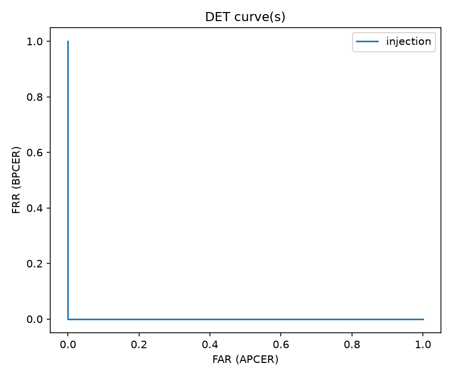
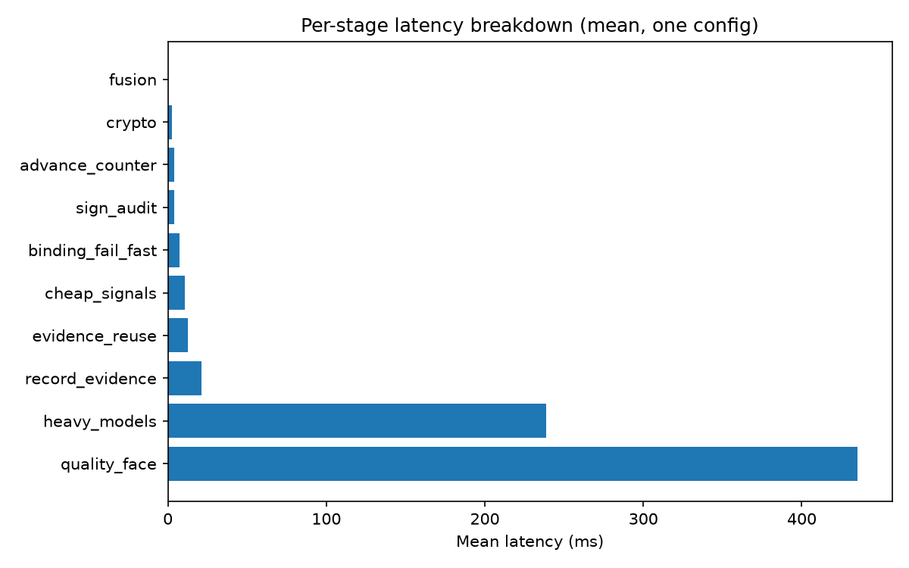
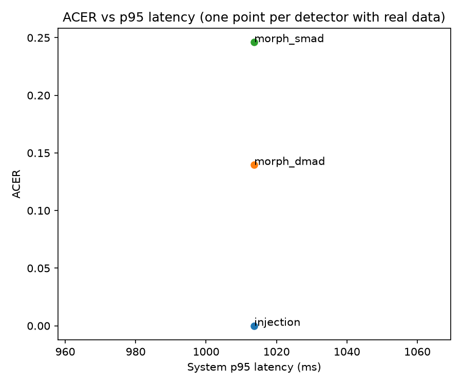
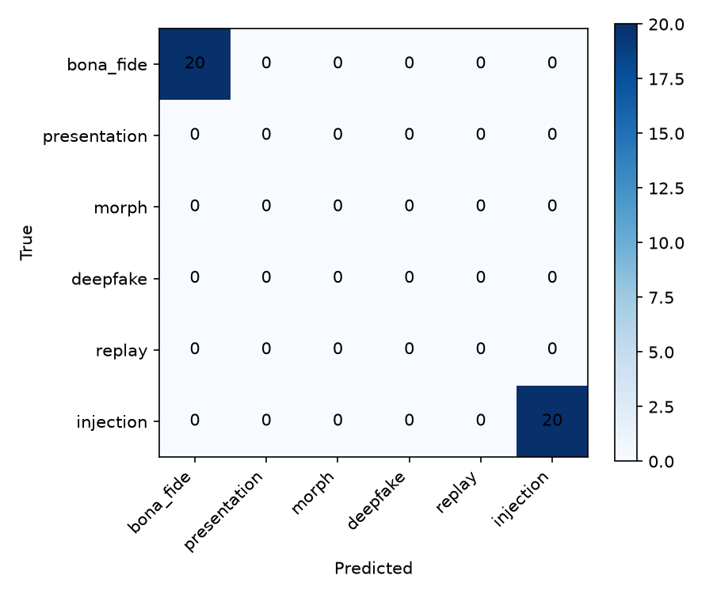

# Evaluation report (PROJECT_SPEC.md §8)

*git `2b0008a8b489` · config `ff38ecf43267` · Linux-6.6.87.2-microsoft-standard-WSL2-x86_64-with-glibc2.41 / x86_64 · KEM=liboqs SIG=liboqs · seed=2026 · generated 2026-09-06T19:24:19.445967+00:00*

---

### T1 — Per-detector accuracy, intra-dataset

| Detector | APCER | BPCER | ACER | EER | AUC-ROC | TDR@FAR=1% | n_genuine | n_attack |
|---|---|---|---|---|---|---|---|---|
| deepfake | BLOCKED — no deepfake detector implemented -- pqbio/detect/deepfake.py is deliberately absent, not stubbed (dataset-blocked, see CLAUDE.md 'Current state' / PROJECT_SPEC.md §14) |  |  |  |  |  |  |  |
| injection | 0.0000 | 0.0000 | 0.0000 | 0.0000 | 1.0000 | 1.0000 | 6 | 6 |
| match | BLOCKED — no labelled genuine/impostor pair dataset exists to compute match FAR/FRR (§6) |  |  |  |  |  |  |  |
| morph_dmad | 0.1104 | 0.1688 | 0.1396 | 0.1375 | 0.9295 | 0.1500 | 160 | 154 |
| morph_smad | 0.2922 | 0.2000 | 0.2461 | 0.2438 | 0.8369 | 0.0437 | 160 | 154 |
| pad | BLOCKED — no pad detector implemented -- pqbio/detect/pad.py is deliberately absent, not stubbed (dataset-blocked, see CLAUDE.md 'Current state' / PROJECT_SPEC.md §14) |  |  |  |  |  |  |  |
| replay | BLOCKED — no replay detector implemented -- pqbio/detect/replay.py is deliberately absent, not stubbed. Replay-Attack/MSU-MFSD are unlicensed (§6), and the self-recorded alternative is blocked on human subjects rather than hardware: §6 requires written consent and supervisor approval to record anyone, and a subject-disjoint split needs at least two consenting subjects. The capture rig itself is verified working (camera, display, WB/exposure lock -- PROJECT_SPEC.md §14, 2026-09-01) |  |  |  |  |  |  |  |

### T2 — Per-detector accuracy, cross-dataset

| Detector | APCER | BPCER | ACER | EER | AUC-ROC | TDR@FAR=1% | n_genuine | n_attack |
|---|---|---|---|---|---|---|---|---|
| deepfake | BLOCKED — only one dataset exists in this environment (the self-generated injection corpus) -- cross-dataset evaluation needs a second, independent dataset (§6) |  |  |  |  |  |  |  |
| injection | BLOCKED — only one dataset exists in this environment (the self-generated injection corpus) -- cross-dataset evaluation needs a second, independent dataset (§6) |  |  |  |  |  |  |  |
| match | BLOCKED — only one dataset exists in this environment (the self-generated injection corpus) -- cross-dataset evaluation needs a second, independent dataset (§6) |  |  |  |  |  |  |  |
| morph_dmad | BLOCKED — only one dataset exists in this environment (the self-generated injection corpus) -- cross-dataset evaluation needs a second, independent dataset (§6) |  |  |  |  |  |  |  |
| morph_smad | BLOCKED — only one dataset exists in this environment (the self-generated injection corpus) -- cross-dataset evaluation needs a second, independent dataset (§6) |  |  |  |  |  |  |  |
| pad | BLOCKED — only one dataset exists in this environment (the self-generated injection corpus) -- cross-dataset evaluation needs a second, independent dataset (§6) |  |  |  |  |  |  |  |
| replay | BLOCKED — only one dataset exists in this environment (the self-generated injection corpus) -- cross-dataset evaluation needs a second, independent dataset (§6) |  |  |  |  |  |  |  |

### T3 — Fusion strategy comparison

| Strategy | Accuracy |
|---|---|
| rule | 1.0000 |
| cascade | 1.0000 |

_n=40 — Only match/injection/binding/quality signals exist this session — pad/morph/deepfake/replay are dataset-blocked and not built. Both strategies are compared on the injection corpus only (provenance detection), not full system ACER. See pqbio/detect/fusion.py's module docstring._

### T4 — Per-attack detection rate at the deployed operating point

| Attack type | Detection rate |
|---|---|
| deepfake | BLOCKED — no deepfake detector implemented -- pqbio/detect/deepfake.py is deliberately absent, not stubbed (dataset-blocked, see CLAUDE.md 'Current state' / PROJECT_SPEC.md §14) |
| injection_tier1 | 1.0000 |
| morph_dmad | {'acer': 0.1395698051948052, 'apcer': 0.11038961038961038, 'auc_roc': 0.9295454545454546, 'bpcer': 0.16875, 'eer': 0.13749999999999996, 'eer_threshold': 0.6417689809764262, 'far_achieved': 0.01, 'model_path': 'morph_dmad_gbm.txt', 'n_attack': 154, 'n_dropped_no_features': 0, 'n_genuine': 160, 'n_test': 314, 'n_train': 475, 'setting': 'dmad', 'tdr_at_far_1pct': 0.15, 'threshold': 0.5} |
| morph_smad | {'acer': 0.2461038961038961, 'apcer': 0.2922077922077922, 'auc_roc': 0.8368912337662339, 'bpcer': 0.2, 'eer': 0.24375000000000002, 'eer_threshold': 0.40992054028307695, 'far_achieved': 0.01, 'model_path': 'morph_smad_gbm.txt', 'n_attack': 154, 'n_dropped_no_features': 0, 'n_genuine': 160, 'n_test': 314, 'n_train': 475, 'setting': 'smad', 'tdr_at_far_1pct': 0.04375, 'threshold': 0.5} |
| presentation | BLOCKED — no presentation detector implemented -- pqbio/detect/pad.py is deliberately absent, not stubbed (dataset-blocked, see CLAUDE.md 'Current state' / PROJECT_SPEC.md §14) |
| replay | BLOCKED — no replay detector implemented -- pqbio/detect/replay.py is deliberately absent, not stubbed. Replay-Attack/MSU-MFSD are unlicensed (§6), and the self-recorded alternative is blocked on human subjects rather than hardware: §6 requires written consent and supervisor approval to record anyone, and a subject-disjoint split needs at least two consenting subjects. The capture rig itself is verified working (camera, display, WB/exposure lock -- PROJECT_SPEC.md §14, 2026-09-01) |

### T4b — MMPMR (morph only)

_Threshold: `match_cosine_min` = 0.38._

| Morph method | n | MMPMR (verifies as ALL contributors) | Verifies as ANY contributor | Mean min similarity |
|---|---|---|---|---|
| landmark_alpha | 195 | 0.1077 | 0.4615 | 0.2341 |
| spliced_jpeg | 195 | 0.0205 | 0.7231 | 0.1575 |
| **all methods** | 390 | **0.0641** | 0.5923 |  |

**Read this before the morph rows of T1/T4.** MMPMR is 0.0641 at `match_cosine_min` = 0.38: most of these morphs do not verify as both contributors, so they would not have fooled the matcher in the first place and the detection metrics largely describe the detection of failed attacks. Cause and consequences in §12 item 8.

### T4c — Morph cross-method generalisation

AUC near 0.5 means the detector learned the *generator*, not morphing. Compare against the within-corpus rows of T1: the gap is the honest number (§12 item 9).

| Setting | Train → test | ACER | EER | AUC-ROC | APCER |
|---|---|---|---|---|---|
| DMAD | train landmark_alpha → test spliced_jpeg | 0.2030 | 0.1813 | 0.8843 | 0.3247 |
| DMAD | train spliced_jpeg → test landmark_alpha | 0.1043 | 0.1000 | 0.9598 | 0.0649 |
| SMAD | train landmark_alpha → test spliced_jpeg | 0.4764 | 0.4313 | 0.5856 | 0.9091 |
| SMAD | train spliced_jpeg → test landmark_alpha | 0.3980 | 0.3377 | 0.7638 | 0.7273 |

### T5 — Crypto micro-benchmarks and artefact sizes

| Operation | Backend | Mean (ms) | p95 (ms) | Iterations |
|---|---|---|---|---|
| kem/classical/keygen | x25519 | 0.0527 | 0.0634 | 1000 |
| kem/classical/encaps | x25519 | 0.1189 | 0.1604 | 1000 |
| kem/classical/decaps | x25519 | 0.0935 | 0.1362 | 1000 |
| kem/classical/artefact_sizes_bytes | x25519 | {"ct": 32, "pk": 32, "sk": 32, "ss": 32} |  |  |
| kem/pq/keygen | liboqs | 0.0340 | 0.0531 | 1000 |
| kem/pq/encaps | liboqs | 0.0219 | 0.0269 | 1000 |
| kem/pq/decaps | liboqs | 0.0255 | 0.0307 | 1000 |
| kem/pq/artefact_sizes_bytes | liboqs | {"ct": 1088, "pk": 1184, "sk": 2400, "ss": 32} |  |  |
| signer/classical/keygen | ed25519 | 0.0340 | 0.0368 | 1000 |
| signer/classical/sign | ed25519 | 0.0589 | 0.0654 | 1000 |
| signer/classical/verify | ed25519 | 0.0852 | 0.0914 | 1000 |
| signer/classical/artefact_sizes_bytes | ed25519 | {"pk": 32, "sig": 64, "sk": 32} |  |  |
| signer/pq/keygen | liboqs | 0.0424 | 0.0486 | 1000 |
| signer/pq/sign | liboqs | 0.1038 | 0.2242 | 1000 |
| signer/pq/verify | liboqs | 0.0406 | 0.0470 | 1000 |
| signer/pq/artefact_sizes_bytes | liboqs | {"pk": 1952, "sig": 3309, "sk": 4032} |  |  |

### T6 — Four-configuration overhead ablation

| Config | Crypto | AI | Isolates | Mean latency (ms) |
|---|---|---|---|---|
| C0 | none | none | framework/transport floor | 1.3242 |
| C1 | X25519 + Ed25519 | none | conventional crypto cost | 8.9787 |
| C2 | ML-KEM-768 + ML-DSA-65 | none | marginal PQ cost | 9.3158 |
| C3 | ML-KEM-768 + ML-DSA-65 | full | total system cost | 793.8619 |

**PQ overhead (C2-C1):** 0.3371 ms (3.8%)

**AI overhead (C3-C2):** 784.5461 ms (8421.6%)

**AI:PQ overhead ratio:** 2327.18

_The AI:PQ ratio is **provisional and a lower bound on the AI side**: C3 runs only one of the six spec'd detectors (injection). pad/morph/deepfake/replay are absent (§6/§14), so the AI term is missing four of its five attack-detection components. Adding them can only increase C3, pushing the ratio further in the same direction — nothing about them could shrink it. The PQ term (C2−C1) is not provisional; both configs are complete._

### T7 — Throughput vs concurrency

| Concurrency | Throughput (verif/s) | p50 (ms) | p95 (ms) | p99 (ms) | Setup failed (409) | Expired before verify (409) |
|---|---|---|---|---|---|---|
| 1 | 2.007 | 497.8876 | 497.8876 | 497.8876 | 0 | 0 |
| 2 | 1.807 | 878.2618 | 1069.0575 | 1086.0171 | 0 | 0 |
| 4 | 2.566 | 1186.6361 | 1523.3108 | 1531.6550 | 0 | 0 |
| 8 | 3.006 | 2487.3475 | 2624.0138 | 2624.2610 | 0 | 0 |
| 16 | 2.902 | 4982.7240 | 5327.6534 | 5443.9851 | 0 | 0 |
| 32 | 3.045 | 10238.4695 | 10357.1016 | 10380.8477 | 0 | 0 |
| 64 | 2.985 | 20928.1411 | 21279.4197 | 21332.8282 | 0 | 0 |

**Knee:** concurrency=1 — throughput gain from concurrency=1 to 2 was -9.9%, below the 10% threshold

**Event-loop-blocking finding:** Below saturation, p99 grew 20.85x while concurrency grew 32x (concurrency=1->32, peak throughput 3.05/s). That is at or above proportional growth.  Past the peak, p99 rises to 21333ms at concurrency=64 (from 498ms at 1) while throughput stays flat — expected queueing against a saturated worker pool (`server.workers` in config), not a separate defect. NOTE: latency growth alone cannot separate a blocked event loop from ordinary worker-pool/CPU saturation on a CPU-bound workload, so do not read the ratio above as a verdict on its own. The direct discriminator is tests/integration/test_server_happy_path.py::test_event_loop_stays_responsive_while_verify_is_in_flight, which polls GET /v1/health while concurrent /v1/verify calls are in flight and requires it to stay responsive — a blocked loop would stall those health checks behind the CPU-bound work, whatever the latency curve looks like.

### T8 — Deployment recommendation matrix

**Provisional — based on measured latency/throughput/PQ-overhead numbers only.** A real ACER-vs-scenario recommendation (§8.4) needs the four missing detectors and real datasets (§6/§14); this matrix cannot yet weigh accuracy against latency per scenario, only latency and crypto cost, which are real.

| Scenario | Recommendation (latency/crypto-only) |
|---|---|
| High-security, low-volume (bank onboarding) | Maximise detection strength once available; the system's own p95 (1013.6619 ms) is not the binding constraint at low volume. Crypto choice is not the trade-off axis here at all. |
| Balanced (mobile login) | PQ is affordable on these numbers: the measured PQ overhead is 0.34 ms per session (T6), 0.03% of end-to-end p95. The cost that matters for this scenario is inference, not crypto. |
| High-volume, low-latency (access control) | T7's knee bounds this scenario. Throughput saturates against `server.workers` running per-request ONNX inference, so scale that (or move inference to a GPU) — dropping PQ for classical crypto would buy back only 0.34 ms per session and is not the lever. |

---

### F1 — DET curves

### F2 — Stage-level latency breakdown

### F3 — ACER vs p95 latency

_Only one real (ACER, p95) pair exists (injection); this plot cannot yet show the trade-off curve §8.4 asks for across strategies/detectors._

### F4 — 6-class confusion matrix

Samples counted in the matrix: **40**

Rejections excluded (named no attack class): **0** — forged signature, expiry, nonce replay, counter regression, quality failure, unevaluable challenge. Excluded rather than folded into the nearest class, which would invent an attribution the system never made (§8.1).

Total decisions: **40**

Decisions carrying more than one attack attribution: **0** — collapsed to a single label by ATTACK_CODE_PRECEDENCE. A large count here means this matrix is hiding most of what the system found, and the per-attack rates (T4) should be read instead.

_Only bona_fide and injection have real labelled samples in this environment; presentation/morph/deepfake/replay rows and columns are structurally zero, not measured-and-found-zero (§14)._

---

See `results/BLOCKERS.md` for the complete list of blocked metrics and what unblocks each one.
